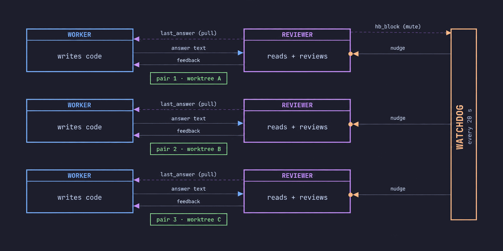

# herdr-pair-coding

Linux and macOS (Windows via WSL). Worker–reviewer pair coding on top of
[herdr](https://herdr.dev): one agent writes, another reviews, each in its own
pane.

## How It Works




The GIF is a real recorded session, not a mock-up. The recording pipeline
(pty capture -> cast -> frames -> GIF), the raw cast and the theme stills live in
[`docs/demo`](docs/demo/README.md).

## Set up with your agent

```text
Help me set up herdr-pair-coding: https://raw.githubusercontent.com/HYPERVAPOR/herdr-pair-coding/main/skills/herdr-pair-coding/SKILL.md
```

## What's inside

| Tool                                               | Role                                                                                        |
| -------------------------------------------------- | ------------------------------------------------------------------------------------------- |
| [`herdr-watchdog`](herdr-watchdog/README.md)       | 20 s heartbeat; nudges or interrupts a stalled worker/reviewer pair; `hb_block` silences it |
| [`herdr-last-answer`](herdr-last-answer/README.md) | reviewer reads the worker's answer text, no TUI footer, no width truncation                 |
| [`refs-reclaim`](refs-reclaim/README.md)           | archives and removes worktrees/branches only after proving them safe                        |
| [`resume-profile`](resume-profile/README.md)       | restores a pane as the same role (`pi-profile <role> --session ...`), not as bare pi         |

Only the role guard loads in a normal `pi` session; it registers no tool and
just warns when a pane's label and profile disagree. Everything above is mounted
explicitly: the role profiles load `last_answer`/`hb_block` and the resume
reporter, and `refs-reclaim/reclaim.ts` only where you ask for it.

## Safety

`refs-reclaim` is read-only until `archive`/`apply`; `apply` requires
`confirm=true` and `--yes` and leaves alone anything it cannot prove safe. The
watchdog only reads state and sends messages.

MIT
